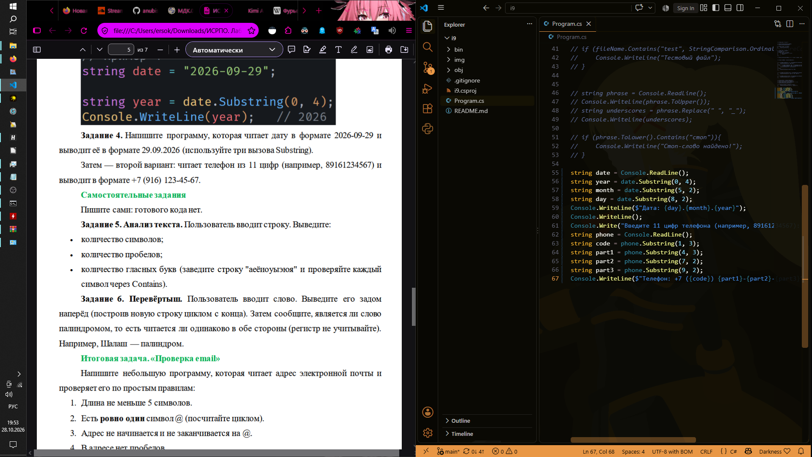
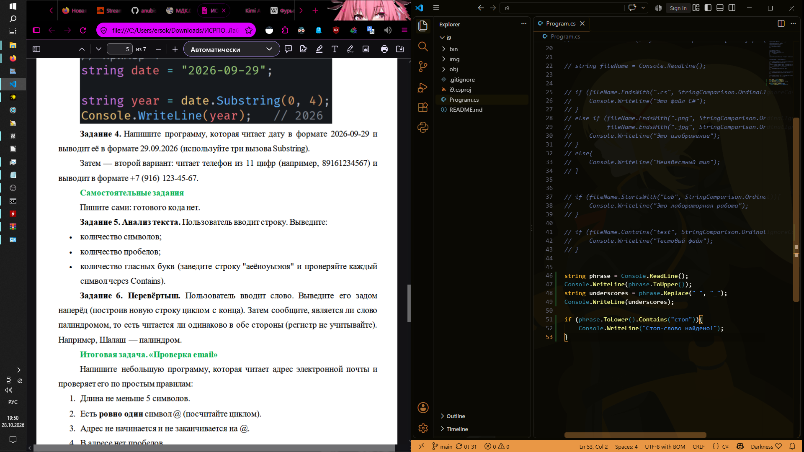

# ISRPO 9

**ФИО:** Чумаченко Михаил
**Группа:** ИСП-242

## Что изучено

1. **Неизменяемость строк:** Строки в C# являются `immutable` (неизменяемыми). Такие методы, как `ToUpper()`, `ToLower()` или `Replace()`, не меняют исходную строку на месте, а возвращают совершенно новую копию. Поэтому результат их работы обязательно нужно сохранять в переменную или сразу выводить в консоль.
2. **Методы поиска и проверки подстрок:** Освоены методы `Contains`, `StartsWith` и `EndsWith`, которые возвращают логическое значение (`true`/`false`) и позволяют удобно валидировать форматы файлов, email-адреса и стоп-слова без написания сложных циклов.
3. **Безопасная склейка через StringBuilder:** При сборке строк в цикле (например, при удалении гласных букв) обычное сложение через `+=` неэффективно тратит память, создавая новый объект на каждой итерации. Использование класса `StringBuilder` из пространства `System.Text` позволяет эффективно модифицировать текстовый буфер без лишних выделений памяти.

## Скриншоты

